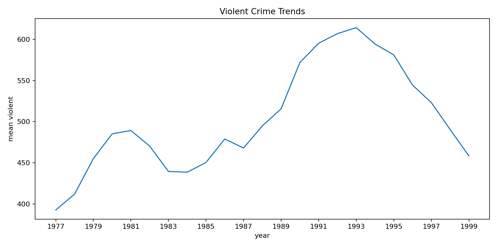

# Violent Crime Trends — executed results

## Decision question
How does the unweighted mean state violent-crime rate change by year?

## Evidence
The first recorded mean is 392.825; the last is 458.490. The recorded period, rather than today, defines this comparison.

Raw rows: 1,173. Rows used: 1,173. Excluded for missing/nonfinite required values or invalid denominator: 0.

## Method
Complete-case descriptive comparison of violent by year; show group counts, mean, minimum and maximum.

## Interpretation and limitations
Equal-state averages are not national population-weighted rates; no gun-law causal effect is estimated. No causal inference, significance claim or production deployment is implied. Missing values are not imputed; identical rows are retained. Small or repeated samples limit uncertainty interpretation.

## Recommended next decision
Use matching population weights and policy identification before evaluating laws.

## Reproducibility
Source and exact downloaded-byte SHA256 are recorded in run_manifest.json. SQL results are in answer.csv and analysis.sqlite. Review quality_audit.csv before interpretation.
